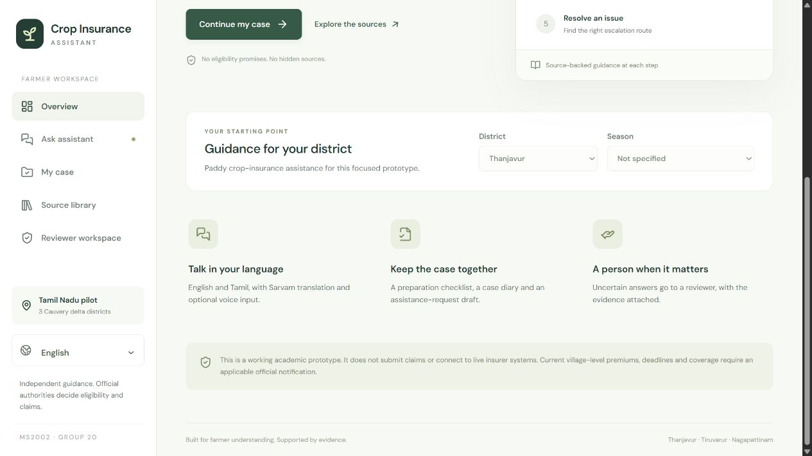

# Crop Insurance Assistant

A working Demo Day prototype for independent farmer support across the crop-insurance journey. React + TypeScript frontend, FastAPI backend, source-grounded retrieval, DeepSeek through AI Credits, and Sarvam for English/Tamil translation and voice input.

**Scope:** Paddy in **Thanjavur, Tiruvarur and Nagapattinam**, Tamil Nadu. The five stages are understanding coverage, preparing documents, reporting loss, following up and resolving grievances.



## What works

- Green responsive React interface, with English and Tamil navigation.
- Official-source ingestion, page-aware chunks, provenance hashes and an inspectable source library.
- District-filtered BM25 + character TF-IDF retrieval. Optional dense embeddings can be added without changing the application.
- DeepSeek produces structured claims and actions; each has citations and supporting quotes. A second grounding check examines the full retrieved passages.
- Tamil questions are translated to English by Sarvam before retrieval; supported answers are translated back. Source quotations remain unchanged. Sarvam speech input produces editable text before the question is submitted.
- Persistent cases, document-readiness checkmarks, a self-reported action diary and an unsubmitted assistance-request draft.
- A real human-review round trip: uncertain question → protected review queue → reviewer selects evidence and writes guidance → farmer sees the correction with citations.

**No API keys are bundled.** With no keys, English retrieval, cases, sources and human review work, but the interface clearly states that no AI answer was issued. It does not use canned answers to impersonate DeepSeek. Tamil navigation works without keys; live Tamil translation and speech need Sarvam.

## Run locally on Windows

Use Python **3.13**. Node **22.12 or newer** and npm are needed only if rebuilding the frontend; this repository includes a compiled frontend in `frontend/dist`.

From this directory in PowerShell:

```powershell
.\setup.ps1
notepad .env
.\start.ps1
```

Open **http://127.0.0.1:8000**. Keep the terminal running.

`setup.ps1` installs the pinned Python dependencies, creates `.env` if absent and generates a local reviewer token. It preserves an existing `.env`. If PowerShell does not allow scripts on your machine, use the equivalent commands below instead of changing your machine policy:

```powershell
python -m venv .venv
python -m pip --python .venv\Scripts\python.exe install -r backend\requirements.lock.txt
Copy-Item .env.example .env
# Edit .env. Set your provider keys and a long random REVIEWER_TOKEN.
cd backend
..\.venv\Scripts\python.exe -m uvicorn app.main:app --host 127.0.0.1 --port 8000
```

On Linux/macOS, use `python3 -m venv .venv`, `.venv/bin/python -m pip install -r backend/requirements.lock.txt`, then run the same uvicorn command from `backend` using `../.venv/bin/python`.

## Configure live AI

Edit the **root `.env`**, never a frontend file:

```dotenv
AICREDITS_BASE_URL=https://api.aicredits.in/v1
AICREDITS_API_KEY=your-real-key
AICREDITS_MODEL=deepseek/deepseek-v3.2
SARVAM_API_KEY=your-real-sarvam-key
SARVAM_TRANSLATE_MODEL=sarvam-translate:v1
SARVAM_STT_MODEL=saaras:v3
REVIEWER_TOKEN=your-long-random-local-secret
```

Restart the backend after changing configuration. The UI reports whether keys are **configured**, not whether your account has credits or the provider is reachable. Check one English question, one Tamil question and a short voice recording before presenting. Paid requests use your own provider accounts; an answered question normally needs generation plus one verification call, with additional Sarvam calls for Tamil.

The default model ID is `deepseek/deepseek-v3.2`. If your AI Credits account exposes a different model, change `AICREDITS_MODEL` to the exact catalog ID. The adapter uses the provider's OpenAI-compatible chat-completions format; there is no OpenAI API dependency.

Official API references: [AI Credits models](https://aicredits.in/models), [Sarvam translation](https://docs.sarvam.ai/api-reference/text/translate-text), [Sarvam transcription](https://docs.sarvam.ai/api-reference/speech-to-text/transcribe).

## Demo Day

Follow [the five-minute demo script](docs/DEMO_SCRIPT.md). The strongest demonstration is a normal source-backed question followed by an unsupported current premium question that goes to a human reviewer.

Open **Reviewer workspace** and enter the `REVIEWER_TOKEN` from your local `.env`. This is a demo operator role, not a claim that a government official is connected. Reviewer responses are separately attributed and never silently replace the AI conversation.

## Source coverage

The bundled snapshot contains **838 chunks from six official sources**, fetched on **7 November 2026**. Of these, **110 historical tender chunks are archived and excluded from answer retrieval**. Individual district searches also exclude other districts' local documents.

| Source | Role |
| --- | --- |
| PMFBY Operational Guidelines 2023 | National framework; page citations retained |
| PIB grievance release, 2 December 2025 | Government information about grievance handling |
| Thanjavur Agriculture page | District context |
| Tiruvarur Agriculture page | District context |
| Nagapattinam Agriculture page | District context |
| Tamil Nadu tender covering 2024–25 / 2025–26 | Historical reference only; excluded from answers |

The exact URLs, dates, hashes and ingestion results are in `data/sources.json` and `data/manifest.json`; downloaded originals are in `data/raw`.

**The snapshot does not establish current village-level coverage, premiums, enrolment deadlines or the appointed insurer for a selected season.** Those questions deliberately require review. Selecting a district or season is context, not confirmation of insurance availability. This prototype does not automatically adopt newly added documents as validated current notifications.

To refresh the allowlisted sources:

```powershell
.\.venv\Scripts\python.exe scripts\ingest.py
```

Review the manifest for errors and inspect changed documents before restarting the server. Scanned PDFs without extractable text need a separately reviewed OCR step; no OCR quality is claimed here. Rebuild a dense index after any corpus change.

## Optional dense retrieval

The default retriever runs locally with no embedding API cost. To add a third retrieval signal, set `EMBEDDING_MODEL` to an embedding model actually supported by your AI Credits account, then run:

```powershell
.\.venv\Scripts\python.exe scripts\embed.py
```

This sends the public source passages to the configured embedding service and incurs its usage charges. Restart the backend. A cached index is loaded only when its model and source identities match. Dense retrieval is optional and was not live-tested without credentials.

## Develop and test

```powershell
# Frontend development: use another terminal while the backend runs.
cd frontend
npm ci
npm run dev
# Production build, after frontend changes:
npm run build
```

Vite development runs on `127.0.0.1:5173` and proxies `/api` to port 8000. The production frontend is served by FastAPI. Rebuild and reload the browser after edits; restart the backend if the build directory did not exist when it started.

```powershell
# From the project root:
.\test.ps1
```

**Validation:** 29 automated tests passed; TypeScript checking and the production build passed. Browser checks covered source retrieval, the missing-notification review loop, cited reviewer guidance, document checkmarks, case diary and the Tamil mobile layout. See [validation details](docs/VALIDATION.md).

Live DeepSeek/Sarvam quality, voice transcription and account access were **not** verified because real provider keys were not supplied. Provider contract tests use stubs. Tamil text needs a native-speaker review before field use.

## Boundaries and privacy

This is a local academic proof of concept, not a production government service. It does not submit claims, retrieve insurer status, assess crop damage, decide eligibility or approve compensation. Case events are self-reported. Document preparation stores checkmarks, not uploaded identity, bank or loss documents.

Questions can be sent to AI Credits and Sarvam only after explicit UI consent. Common identifiers are redacted before model processing and storage, but pattern matching is not comprehensive anonymisation. Voice audio goes to Sarvam for transcription and is not saved by the app. Use synthetic farmer information in the demo.

Case access uses a per-case bearer token stored in this browser; the database stores its hash. Reviewer access uses a shared local secret held in memory by the UI. `.env`, SQLite databases, keys, caches and local tooling are excluded from Git. Do not expose this backend publicly without proper user authentication, role management, HTTPS, persistent storage, distributed rate limits and a retention policy.

No hosting is configured. A GitHub repository stores the project; it does not by itself run the Python API. See [architecture and limitations](docs/ARCHITECTURE.md).
