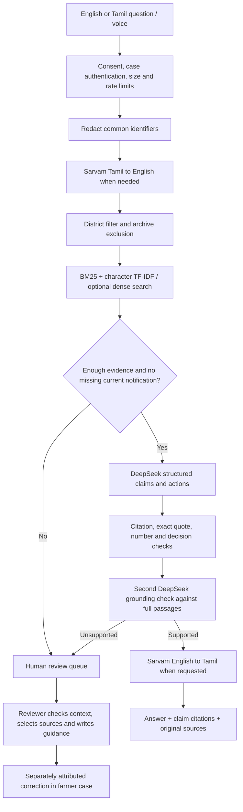

# Architecture

## Modules

| File | Responsibility |
| --- | --- |
| `scripts/ingest.py` | Trusted source allowlist, bounded downloads, hashes, page-aware chunks and manifest |
| `scripts/embed.py` | Optional paid dense index construction |
| `backend/app/retrieval.py` | BM25, character TF-IDF, reciprocal rank fusion, optional dense signal, scope filtering |
| `backend/app/providers.py` | AI Credits and Sarvam adapters, timeouts, transient retries and sanitised errors |
| `backend/app/pipeline.py` | Translation, retrieval, generation, verification and fail-closed responses |
| `backend/app/guards.py` | Identifier patterns, injection patterns, notification gate, claim checks |
| `backend/app/schemas.py` | Explicit request/response shapes and scope constraints |
| `backend/app/store.py` | SQLite case, message, review and event persistence |
| `backend/app/main.py` | API, case ownership, reviewer access, consent, limits and frontend serving |
| `frontend/src/Chat.tsx` | Bilingual chat, editable speech input, citations and evidence inspection |
| `frontend/src/CasePanel.tsx` | Preparation checklist, diary, draft and review results |
| `frontend/src/Review.tsx` | Human-review queue, source search and cited corrections |

## Retrieval and reasoning

The default search combines word relevance with character n-gram similarity. This is retrieval-augmented generation even without a vector database: the model receives retrieved document passages, not a hard-coded FAQ. The small corpus fits in memory. The optional dense index adds semantic similarity as a third rank signal.

District and historical-source filters run before ranking. Reciprocal rank fusion combines up to 40 candidates from each signal; the top five eligible passages are used, with a maximum of two from one source page. Ranking scores and term-overlap thresholds are heuristics, not calibrated probabilities.

DeepSeek receives the selected case profile, question, recent user questions and retrieved passages. Previous AI answers are not evidence. The model must return schema-validated claims, actions, citation IDs and supporting verbatim quotes. Numbers must occur in the cited material, and direct approval/entitlement wording is blocked. A separate model call checks whether the full evidence supports every statement, including conditions and scope. The UI shows evidence and a processing trace, not private chain of thought.

These controls reduce unsupported answers; they do not prove correctness. Regex injection detection is incomplete, an LLM verifier can agree with an LLM mistake, and a matching number can occur in the wrong context. There is no measured accuracy claim or invented confidence percentage.

## Language path

Tamil input is translated with Sarvam before retrieval. Supported English output is translated claim by claim. Numeric information is checked across translation; failures withhold the response. The original English answer and original source passages remain inspectable. Human reviewers write in the appropriate language; their authored text is not automatically translated or replaced. UI translations are static and work offline.

Speech records up to 25 seconds in the browser, posts at most 5 MB to Sarvam and returns editable text. The app does not retain audio. It does not implement speech output. Native-speaker assessment and live audio validation remain necessary.

## Human-in-the-loop choice

Questions needing a current notification, lacking evidence or failing grounding produce `needs_review`. The server persists the question, case context and retrieved evidence in a pending queue. A reviewer enters a separate secret, inspects evidence, searches within the same district scope, selects source IDs and writes a response. The server rejects invalid/out-of-scope/archive citations and duplicate resolution. The farmer sees the response and the selected source passages under Human review.

This is a clarification workflow, not government grievance filing or insurance adjudication. The server checks source identity and scope; it does not certify the quality of a human-authored answer. Missing credentials and provider outages are shown explicitly and do not become fabricated model responses.

## API map

| Endpoint | Access / purpose |
| --- | --- |
| `GET /api/health`, `GET /api/sources` | Public local configuration flags and source metadata; no secrets |
| `POST /api/cases` | Create scoped case; returns access token once |
| `GET/PUT/DELETE /api/cases/{id}` | Case bearer token; district/crop/season immutable after creation |
| `POST /api/cases/{id}/chat` | Case token + consent; grounded pipeline |
| `POST /api/cases/{id}/speech` | Case token + consent; Sarvam transcription |
| `POST /api/cases/{id}/events` | Case token; self-reported event |
| `GET /api/cases/{id}/draft` | Case token; unsubmitted plain-text draft |
| `GET /api/reviews` | Reviewer token; review queue |
| `GET /api/reviewer/evidence` | Reviewer token; scoped source search |
| `POST /api/reviews/{id}` | Reviewer token; publish human guidance with citations |

## Deployment boundary

The reference deployment is one localhost FastAPI process serving the built React app and a local SQLite database. SQLite is not suitable as an ephemeral serverless filesystem. Frontend and backend deployment requires a reachable API and deliberate authentication/CORS/storage design. Do not simply publish this process or use `--host 0.0.0.0` as a production deployment plan.

The prototype has no external action tools: it cannot submit a claim, email an official or silently upload a farmer's documents. New source URLs are developer-managed; model text and public API input cannot initiate arbitrary document downloads.
